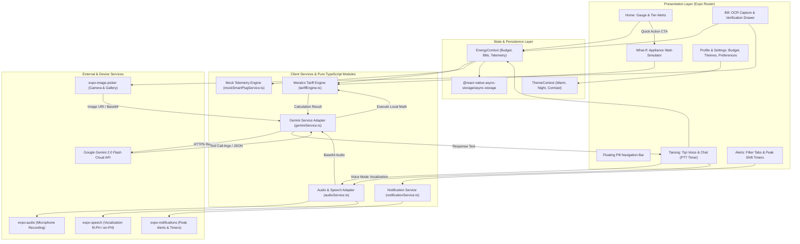

# KuryenTipid: Mobile Energy Intelligence & Bill Auditing App

*   **Author:** Team OhmMyGrid
*   **Status:** Draft
*   **Date:** 2026-11-12

--------------------------------------------------------------------------------

## Overview

KuryenTipid is an Expo Go React Native mobile application tailored for residential electricity consumers within the Manila Electric Company (Meralco) distribution franchise in the Philippines. It converts passive, retrospective utility billing into active, day-to-day household energy management.

The application integrates four core pillars:
1. **Stepped Tariff Modeling:** Accurately reflects Meralco's non-linear Distribution Utility (DSM) brackets, surfacing marginal cost cliffs rather than flat-rate averages.
2. **Standalone Mock Telemetry:** Generates realistic 30-minute interval smart plug consumption data for testing and demonstrations without requiring physical hardware or third-party cloud authentication.
3. **Multimodal Bill Digitization:** Uses Google Gemini 2.0 Flash to extract essential billing fields from paper bills, backed by an inline manual entry fallback for illegible or degraded documents.
4. **Context-Aware Conversational Coach ("Tipi"):** Delivers localized Taglish guidance with deterministic Gemini function calling. Provides a quiet text-only mode for typed questions, and an interactive 3-second push timer for vocalized voice queries.
5. **Peak-Hour Shift Scheduling ("Oras-Tipid"):** Proactively alerts users ahead of peak tariff windows (8 AM – 9 PM) and provides countdown timers to defer heavy appliance loads to off-peak periods.

## The Problem

Residential consumers across Metro Manila regularly face unexpected "bill shock" (*gulat sa kuryente*). Because Meralco delivers paper bills weeks after consumption occurs, households cannot observe how daily appliance habits compound into higher cost brackets.

Three structural obstacles drive this problem:
- **Complex, Stepped Rate Structures:** Meralco charges distribution fees across escalating consumption brackets (0–200 kWh, 201–300 kWh, 301–400 kWh, >400 kWh). Crossing 200 kWh moves subsequent consumption into higher price tiers, a mechanism most consumers do not know.
- **Physical Document Friction:** Dense tables of pass-through charges on paper bills make manual tracking slow and error-prone.
- **Inaccessible Advice:** Generic calculators present static numeric tables rather than practical guidance in everyday multilingual Taglish.

KuryenTipid resolves these issues by presenting a real-time budget gauge that tracks consumption against stepped rate tiers, an interactive "What-If" simulator that models appliance adjustments, automated bill extraction, and an accessible voice assistant.

## Goals

*   **G1: Expo Go Portability:** Deliver the entire application within standard Expo Go (Expo SDK 58, React Native 0.88) without requiring custom native compilation or bare Android/iOS project ejections.
*   **G2: Accurate Stepped Tariff Calculation:** Implement a pure TypeScript calculation engine modeling Meralco residential distribution tiers, pass-through charges, and VAT, maintaining 100% test coverage with verifiable unit test assertions.
*   **G3: Streamlined Bill Digitization with Fallback:** Extract required billing fields (Customer Account Number, Billing Period, Total kWh, Total Amount Due, Due Date, Generation Charge) using Gemini 2.0 Flash multimodal vision, with an immediate, editable review drawer and manual entry fallback for damaged bills.
*   **G4: Deterministic Taglish Voice & Text Assistant:** Provide dual-modality interaction with Tipi:
    *   *Typed Questions:* When the user types a query into the chat input, Tipi responds silently with text bubbles only.
    *   *Voice Questions with 3-Second Push Timer:* When the user activates the microphone button, a 3-second push timer records the spoken query (with animated countdown feedback), sends it to Gemini 2.0 Flash with Function Calling, and speaks the response aloud via `expo-speech` (`fil-PH`).
*   **G5: Zero-Dependency Telemetry Demonstration:** Include an internal mock telemetry service that generates realistic 30-minute interval energy data and supports interactive demo events (fast-forwarding cycles, injecting load spikes).
*   **G6: Accessible Multi-Theme Support:** Support Warm Paper, Night Slate, and High Contrast design tokens alongside dynamic font scaling (1.0x, 1.15x, 1.3x) across all views.
*   **G7: Peak-Hour Notifications & Load Shifting:** Automate scheduled daily peak/off-peak notifications and provide configurable appliance delay countdowns using `expo-notifications`.

## Non-Goals

*   **NG1: Direct Hardware BLE Pairing:** Direct Bluetooth Low Energy pairing with physical smart plugs is explicitly out of scope to preserve standard Expo Go runtime compatibility.
*   **NG2: In-App Utility Bill Payments:** Integration with payment gateways (e.g., GCash, Maya, credit card processors) is excluded; the app is an analytical and advisory tool.
*   **NG3: Utility Central Grid (AMI) Integration:** Live data feeds from Meralco's central Advanced Metering Infrastructure are excluded due to the lack of public utility API endpoints.
*   **NG4: Hands-Free Ambient Wake-Word:** Continuous ambient listening ("Hey Tipi") is excluded due to mobile OS background execution restrictions and battery consumption.
*   **NG5: Granular Sub-Charge Extraction:** Line-by-line parsing of dozens of pass-through regulatory line items (e.g., NPC Stranded Debts, FIT-All, DAA) is omitted from OCR extraction in favor of core summary fields.

## Architectural Decisions & Scope Boundaries

*   **Decision 1 (API Key Configuration):** The Gemini API key is configured strictly via the local environment file (`.env` via `EXPO_PUBLIC_GEMINI_API_KEY`) for zero-friction hackathon execution.
*   **Decision 2 (Appliance Presets Scope):** The What-If Watt-Calculator is bounded to 5 standard household presets in the MVP (1.5 HP Inverter AC, 1.0 HP Non-Inverter AC, Refrigerator, Electric Fan, Water Heater). User-customizable wattage entry is designated for post-MVP enhancements.

## Critical User Journeys (CUJs)

### CUJ 1: Real-Time Budget Tracking & Tariff Tier Cliff Warning
*   **Given**: A household with a ₱3,500 monthly electricity budget has accumulated 188 kWh on day 20 of their billing cycle.
*   **When**: The user opens KuryenTipid.
*   **Then**: The home dashboard displays the current projected bill (₱2,840), an animated circular gauge at 81% of budget, and an amber warning alert indicating that only 12 kWh remain before crossing into Meralco's higher-rate Tier 2 bracket (201–300 kWh).

### CUJ 2: Multimodal Bill Ingestion with Manual Fallback
*   **Given**: The user has received their latest monthly paper bill from Meralco.
*   **When**: The user takes a photo or selects an image of the bill from the Bill screen.
*   **Then**: Gemini 2.0 Flash extracts the Customer Account Number, Billing Period, Total kWh, Total Amount Due, and Due Date. A verification bottom drawer displays these values for review. If the bill image is blurred or OCR fails, the user taps "Manual Input" to fill the pre-structured fields directly, updating their active tariff parameters.

### CUJ 3: Dual-Modality Consultation with Tipi (Silent Text vs. 3-Second Push-to-Speak)
*   **Given**: The user wants to ask about their electricity usage.
*   **When (Scenario A - Text)**: The user types *"Bakit mataas ang bill?"* in the chat box and taps send.
*   **Then (Scenario A)**: Tipi processes the query via Gemini and replies with text bubbles only, keeping the interaction silent.
*   **When (Scenario B - Voice)**: The user taps the microphone button.
*   **Then (Scenario B)**: A 3-second push timer recording window opens with a visual pulsing countdown ("Nakikinig... 3s"). Upon timer completion, the audio snippet is sent directly to Gemini 2.0 Flash. Tipi triggers `getBudgetStatus` to fetch actual telemetry and vocalizes the concise answer via `expo-speech` while appending the response bubble in the chat transcript.

### CUJ 4: What-If Appliance Simulation
*   **Given**: The user wants to lower their projected bill before the cycle ends.
*   **When**: The user opens the What-If Watt-Calculator, adjusts the Inverter AC temperature setting from 20°C to 24°C, and reduces daily runtime by 2 hours.
*   **Then**: The calculation engine recalculates consumption delta and tariff step impact, displaying an estimated monthly savings of ₱482 along with a clear formula breakdown.

### CUJ 5: Peak-Hour Appliance Shift Notification & Delay Timer
*   **Given**: It is 7:55 AM on a weekday.
*   **When**: The system clock reaches 7:55 AM.
*   **Then**: `expo-notifications` delivers a local alert: *"Magsisimula na ang Peak Hours (8 AM – 9 PM). Ipagpaliban ang paggamit ng plantsa o washing machine para makatipid."* In the Alerts tab, the user taps "Plantsa" and selects a 2-hour delay reminder, triggering an automatic prompt once off-peak conditions approach.

--------------------------------------------------------------------------------

## Technical Plan (Architecture)

### System Architecture Overview



### Component Breakdown & Interfaces

#### 1. Presentation & Navigation Subsystem
*   **Root Layout (`src/app/_layout.tsx`):** Wraps application in `ThemeProvider` and `EnergyProvider`. Configures status bar styling and global font scaling.
*   **Tab Navigator (`src/app/(tabs)/_layout.tsx`):** Implements a custom bottom floating pill navigator (`FloatingPillNav`) with 5 target triggers:
    *   `index.tsx`: Home Dashboard.
    *   `bill.tsx`: Bill Breakdown and OCR Ingestion.
    *   `tanong.tsx`: Center elevated Action Button (`mic` icon) triggering the Tipi voice/chat interface.
    *   `alerts.tsx`: Notifications categorized by `all`, `budget`, and `peak`, with appliance shift timers.
    *   `profile.tsx`: Household parameters, monthly budget controls, and accessibility themes.
*   **What-If Modal Screen (`src/app/whatif.tsx`):** Standalone modal route for real-time appliance temperature and operating hour adjustments, launched directly from HomeView via the primary "Subukan ang What-If Watt-Calculator" quick-action card.

#### 2. Tariff & Mathematical Modeling Subsystem (`src/lib/tariffEngine.ts`)
A dependency-free TypeScript module providing verified Meralco residential rate calculations.

*   **Stepped Distribution Brackets (DSM):**
    $$D(K) = \begin{cases}
      K \cdot r_{d1} & \text{if } K \le 200 \\
      200 \cdot r_{d1} + (K - 200) \cdot r_{d2} & \text{if } 200 < K \le 300 \\
      200 \cdot r_{d1} + 100 \cdot r_{d2} + (K - 300) \cdot r_{d3} & \text{if } 300 < K \le 400 \\
      200 \cdot r_{d1} + 100 \cdot r_{d2} + 100 \cdot r_{d3} + (K - 400) \cdot r_{d4} & \text{if } K > 400
    \end{cases}$$
*   **Pass-Through Components:**
    $$B(K) = \left( R_{\text{gen}} + R_{\text{trans}} + R_{\text{loss}} \right) \cdot K + D(K) + S(K) + T(K)$$
    Where $S(K)$ handles the Lifeline Subsidy adjustment for consumption over 100 kWh, and $T(K)$ applies 12% statutory VAT and universal charges.
*   **Tier Cliff Detection:**
    Calculates remaining kWh buffer before transitioning into the next bracket:
    $$\Delta K_{\text{next}} = \text{BracketThreshold} - K_{\text{projected}}$$
*   **What-If Delta Calculation:**
    Computes savings by comparing baseline monthly energy consumption against the adjusted profile:
    $$E_{\text{base}} = \frac{\text{Wattage} \cdot \text{Hours}_{\text{base}} \cdot 30}{1000}$$
    $$E_{\text{new}} = \frac{\text{Wattage} \cdot (1 - \Delta \text{Temp} \cdot 0.04) \cdot (\text{Hours}_{\text{base}} - \Delta \text{Hours}) \cdot 30}{1000}$$
    $$\Delta \text{Monthly kWh} = E_{\text{base}} - E_{\text{new}}$$
    The engine recalculates the full Meralco bill under $E_{\text{new}}$ to capture both base kWh savings and any downward distribution tier transition bonuses.

#### 3. In-App Telemetry Simulator (`src/lib/mockSmartPlugService.ts`)
Implements `SmartPlugClient` interface without external cloud dependencies:
*   Generates 30-minute interval telemetry records:
    ```typescript
    export interface TelemetryReading {
      timestamp: string; // ISO 8601
      powerWatts: number;
      intervalKwh: number;
      applianceId: string;
      applianceName: string;
    }
    ```
*   Simulates realistic power profiles:
    *   *Inverter AC:* Starts at 1100W pull, stabilizes down to 280W–350W once room thermal setpoint is met.
    *   *Refrigerator:* Cycles between 120W (compressor on) and 5W (idle) every 45 minutes.
    *   *Electric Fan / TV:* Steady load of 45W–95W.
*   **Demo Controls:** Exposes `fastForwardDays(days: number)` to instantly advance the 30-day billing cycle and `injectSpikeLoad(watts: number)` to immediately trigger a Tier Cliff alert.

#### 4. Gemini Multimodal & Function Calling Subsystem (`src/lib/geminiService.ts`)
*   **Vision Ingestion (Meralco Bill Extraction):**
    Calls `models/gemini-2.0-flash:generateContent` with `response_mime_type: "application/json"` and strict schema:
    ```typescript
    export interface ExtractedBillData {
      customerAccountNumber: string;
      billingPeriod: { startDate: string; endDate: string };
      dueDate: string;
      totalKwh: number;
      totalAmountDue: number;
      generationCharge?: number;
    }
    ```
*   **Multimodal Audio & Function Calling:**
    Encodes the completed Push-to-Talk `.m4a` recording to base64 and dispatches it as an inline audio payload to Gemini 2.0 Flash. The system persona is multilingual, dynamically responding in the user's selected language preference (Taglish, Tagalog, or English). Includes two registered function declarations:
    1. `getBudgetStatus()`: Returns current kWh, projected bill, tier, and remaining budget.
    2. `simulateApplianceSavings(params)`: Executes `calculateWhatIfSavings` and returns exact peso and tier deltas.

#### 5. Audio & Speech Subsystem (`src/lib/audioService.ts`)
*   **Recording Pipeline:**
    Uses modern Expo SDK 58 `expo-audio` hook (`useAudioRecorder`).
    When the mic button is pressed, a 3-second timer initiates. Upon timer completion:
    - Audio recording halts.
    - Local `.m4a` file is read via `expo-file-system` into base64.
    - Payload is dispatched to `geminiService`.
*   **Vocalization Pipeline:**
    Uses `expo-speech`:
    ```typescript
    Speech.speak(text, {
      language: 'fil-PH', // Fallback to en-PH if Tagalog voice pack is absent
      pitch: 1.0,
      rate: 0.95
    });
    ```
    *Strict Constraint:* Vocalization executes **only** on voice-initiated queries. Typed text queries trigger zero audio output.

#### 6. Peak-Hour Push Notification & Shift Timer Subsystem (`src/lib/notificationService.ts`)
*   **Daily Scheduled Triggers (`expo-notifications`):**
    *   *7:55 AM Peak Warning:* "Magsisimula na ang Peak Hours (8 AM – 9 PM). Ipagpaliban ang plantsa at washing machine para makatipid."
    *   *9:00 PM Off-Peak Notice:* "Off-peak na! Pwede nang magpatakbo ng heavy appliances."
*   **Appliance Shift Delay Countdown:**
    Allows users to set 1-hour, 2-hour, or custom countdown alarms directly from the peak checklist in `alerts.tsx` to notify them when off-peak hours arrive.

#### 7. Theme & State Management Subsystem
*   **Theme Tokens (`src/constants/theme.ts`):**
    *   *Warm Paper:* Background `#FFFDF9`, Container `#F4EFE6`, Brand Orange `#D95200`, Ink `#0F172A`.
    *   *Night Slate:* Background `#121824`, Container `#1E2638`, Brand Orange `#FF7A29`, Ink `#F8FAFC`.
    *   *High Contrast:* Background `#FFFFFF`, Container `#FFFFFF`, Brand `#000000`, High-vis Yellow `#FFD400`, Ink `#000000`.
*   **Persistence:** All user preferences (theme, budget, Customer Account Number, active bill data, cached telemetry) persist asynchronously in `@react-native-async-storage/async-storage`. Gemini API key is loaded from `.env` (`EXPO_PUBLIC_GEMINI_API_KEY`).


--------------------------------------------------------------------------------

## Alternatives Considered

### Alternative A: Physical Smart Plug Hardware Pairing via Bluetooth Low Energy (BLE)
*   **Pros**: Reads live voltage, amperage, and wattage directly from physical wall sockets in real time.
*   **Cons**: BLE integration requires custom native modules (`react-native-ble-plx`) that cannot execute in vanilla Expo Go, mandating detached prebuilds. Additionally, physical hardware pairing introduces significant failure risks during hackathon judging (venue Wi-Fi client isolation, pairing timeouts, dead batteries).
*   **Reason for Rejection**: A standalone in-app mock telemetry service (`mockSmartPlugService.ts`) simulates realistic 30-minute interval readings with fast-forward demo controls, maintaining complete Expo Go portability and 100% demo uptime.

### Alternative B: Exhaustive 20+ Line-Item Bill OCR
*   **Pros**: Digitizes every fine-print regulatory line item (e.g., NPC Stranded Debts, FIT-All, DAA, Missionary Electrification).
*   **Cons**: Paper bills in the Philippines are frequently crumpled, faded, or smudged. Attempting to parse dozens of dense numeric columns with small fonts drastically increases Gemini multimodal vision hallucinations and request latency.
*   **Reason for Rejection**: Meralco bills can be accurately reconstructed using 6 core summary fields (CAN, billing cycle, total kWh, total amount due, generation charge, due date), supplemented by an immediate manual input fallback if an image is unreadable.

### Alternative C: Unconstrained LLM Generation for Tariff and What-If Math
*   **Pros**: Avoids defining structured tool schemas or integrating a deterministic mathematical engine.
*   **Cons**: Large language models frequently make arithmetic errors when computing compound stepped brackets, percentage reductions per Celsius degree, and statutory VAT.
*   **Reason for Rejection**: Gemini Function Calling enforces deterministic execution by passing extracted parameters directly to the pure TypeScript `tariffEngine`, guaranteeing 100% mathematically correct cost and savings calculations.

### Alternative D: Average Flat-Rate Tariff Modeling (₱15.00 / kWh)
*   **Pros**: Simplifies calculation to a single linear multiplication.
*   **Cons**: Obscures Meralco's 200 kWh and 300 kWh Distribution Utility (DSM) bracket jumps. A flat rate fails to show users that reducing consumption below 200 kWh drops their marginal rate per kWh, neutralizing the primary economic incentive for load shifting.
*   **Reason for Rejection**: Implementing the verified 4-tier piecewise distribution formula accurately reflects true billing economics and tier cliff warnings.

### Alternative E: Hands-Free Continuous Ambient Voice Wake-Word ("Hey Tipi")
*   **Pros**: Enables hands-free conversational invocation from across the room.
*   **Cons**: Modern mobile operating systems (iOS and Android) suspend background microphone listening shortly after the app is backgrounded. Continuous recording also rapidly drains the device battery and triggers microphone privacy indicators.
*   **Reason for Rejection**: A dedicated push-to-talk button with an animated 3-second recording countdown timer provides reliable, battery-efficient interaction without background OS interference.

--------------------------------------------------------------------------------

## Non-Functional Requirements

### Security & Privacy
*   **Local Secrets Management:** Gemini API keys are never hardcoded in version-controlled source files. The app checks `process.env.EXPO_PUBLIC_GEMINI_API_KEY` loaded from `.env`.
*   **On-Device Processing:** All user bills, Customer Account Numbers (CAN), and telemetry logs reside locally on the device in `@react-native-async-storage/async-storage` without external backend telemetry harvesting.

### Performance & Latency
*   **Voice Round-Trip Latency:** Push-to-talk voice query turnaround (audio capture -> base64 conversion -> Gemini Flash inference -> `expo-speech` synthesis) must complete within 2.5 seconds over standard 4G/Wi-Fi.
*   **Instant Tariff Calculations:** The pure TypeScript tariff engine must compute month-end projections and What-If scenarios in under 5 ms with zero UI thread blocking.

### Reliability & Degradation
*   **Offline Mode:** If network connectivity drops during judging, the app gracefully falls back: What-If simulations, mock telemetry generation, and manual bill entry remain 100% operational, while Tipi voice displays an offline badge.

### Accessibility & Ergonomics
*   **Touch Targets:** All interactive buttons, tabs, checkboxes, and step modifiers maintain a minimum touch hitbox of $44 \times 44$ pt in accordance with mobile accessibility standards.
*   **Layout Elasticity:** Text containers and card view components use flexible vertical layouts with explicit wrapping to guarantee zero clipping or visual truncation under 1.3x font scaling.


--------------------------------------------------------------------------------

## Detailed Implementation Plan

### Target Files to Create / Modify / Delete

#### 1. `./package.json` (Modify)
*   **Type / Scope**: Manifest Configuration
*   **Rationale**: Install required Expo SDK 58 modules for routing, audio, speech, vision, notifications, and local storage, and configure Jest test runner.
*   **Public Signatures / Changes**:
    *   Install via SDK resolution: `npx expo install expo-router expo-audio expo-speech expo-image-picker expo-notifications expo-haptics expo-file-system expo-constants expo-linking @react-native-async-storage/async-storage react-native-safe-area-context react-native-screens react-native-svg`
    *   Add `devDependencies`: `jest: ^29.2.1`, `jest-expo: ~58.0.0`, `@types/jest: ^29.5.12`.
    *   Add script: `"test": "jest"`.
*   **Reused Existing Code**: `./package.json#L5-L10` (retaining base `expo`, `react`, `react-native`).
*   **Verify Command**: `npx expo install --check`

#### 2. `./app.json` (Modify)
*   **Type / Scope**: Application Configuration
*   **Rationale**: Register the `expo-router` plugin, configure the deep linking scheme `kuryentipid`, and specify mobile camera and microphone permissions.
*   **Public Signatures / Changes**:
    *   Set `expo.scheme: "kuryentipid"`.
    *   Add `plugins: ["expo-router", ["expo-audio", { "microphonePermission": "Allow KuryenTipid to record voice queries for Tipi." }], ["expo-image-picker", { "photosPermission": "Allow KuryenTipid to select Meralco bill photos.", "cameraPermission": "Allow KuryenTipid to take photos of Meralco bills." }]]`.
*   **Reused Existing Code**: `./app.json#L1-L28`.
*   **Verify Command**: `npx expo-doctor`

#### 3. `./tsconfig.json` (Modify)
*   **Type / Scope**: TypeScript Compiler Config
*   **Rationale**: Configure compiler path aliases for `@/*` mapping to `./src/*`.
*   **Public Signatures / Changes**:
    *   Add `"compilerOptions": { "baseUrl": ".", "paths": { "@/*": ["src/*"] } }`.
*   **Reused Existing Code**: `./tsconfig.json#L1-L6`.
*   **Verify Command**: `npx tsc --noEmit`

#### 4. `./src/constants/theme.ts` (Create)
*   **Type / Scope**: Design Token Constants
*   **Rationale**: Centralize color palettes (Warm Paper, Night Slate, High Contrast), typography, border radii, and font scaling factors.
*   **Public Signatures / Changes**:
    *   `export type ThemeMode = 'warm' | 'night' | 'contrast';`
    *   `export interface ColorTheme { bg: string; surface: string; cont: string; line: string; ink: string; muted: string; brand: string; brandInk: string; ok: string; okBg: string; warn: string; warnBg: string; danger: string; dangerBg: string; peak: string; peakBg: string; }`
    *   `export const THEMES: Record<ThemeMode, ColorTheme>;`
*   **Reused Existing Code**: Color definitions from user's HTML prototype (`:root`, `[data-theme="night"]`, `[data-theme="contrast"]`).
*   **Verify Command**: `npx tsc --noEmit`

#### 5. `./src/types/index.ts` (Create)
*   **Type / Scope**: Data Contracts & Domain Models
*   **Rationale**: Define immutable TypeScript interfaces across the tariff engine, bill scanner, telemetry stream, and UI state.
*   **Public Signatures / Changes**:
    *   `export interface MeralcoRateTable { generationRate: number; transmissionRate: number; systemLossRate: number; distributionTiers: { tier1: number; tier2: number; tier3: number; tier4: number }; lifelineThreshold: number; vatRate: number; }`
    *   `export interface ExtractedBillData { customerAccountNumber: string; billingPeriod: { startDate: string; endDate: string }; dueDate: string; totalKwh: number; totalAmountDue: number; generationCharge?: number; verifiedByUser?: boolean; }`
    *   `export interface TelemetryReading { timestamp: string; powerWatts: number; intervalKwh: number; applianceId: string; applianceName: string; }`
    *   `export interface WhatIfSimulationInput { currentHouseholdKwh: number; baselineTemp: number; targetTemp: number; baselineHoursPerDay: number; reducedHoursPerDay: number; ratedWatts: number; isInverter?: boolean; }`
    *   `export interface WhatIfSimulationResult { kwhSavedMonthly: number; pesoSavedMonthly: number; formulaExplanation: string; achievedTierDrop: boolean; }`
*   **Reused Existing Code**: None (new domain types).
*   **Verify Command**: `npx tsc --noEmit`

#### 6. `./src/lib/tariffEngine.ts` (Create)
*   **Type / Scope**: Pure TypeScript Mathematical Module
*   **Rationale**: Implement piecewise Meralco residential tariff modeling, tier cliff calculations, and appliance What-If savings.
*   **Public Signatures / Changes**:
    *   `export const DEFAULT_MERALCO_RATES: MeralcoRateTable;`
    *   `export function calculateDistributionCharge(kwh: number, rates?: MeralcoRateTable): number;`
    *   `export function calculateMeralcoBill(kwh: number, rates?: MeralcoRateTable): { totalAmountDue: number; breakdown: { generation: number; transmission: number; distribution: number; other: number }; currentTier: number };`
    *   `export function calculateTierCliff(currentKwh: number): { currentTier: number; nextTierThreshold: number; kwhRemaining: number; isCliffWarning: boolean };`
    *   `export function calculateWhatIfSavings(input: WhatIfSimulationInput, rates?: MeralcoRateTable): WhatIfSimulationResult;`
*   **Reused Existing Code**: Rate constants and formulas from HTML prototype (`RATE=15.06`, `PER_DEG=0.04`).
*   **Verify Command**: `npx tsc --noEmit`

#### 7. `./src/lib/mockSmartPlugService.ts` (Create)
*   **Type / Scope**: Telemetry Simulation Engine
*   **Rationale**: Generate deterministic 30-minute interval readings with fast-forward and spike-injection demo controls.
*   **Public Signatures / Changes**:
    *   `export interface SmartPlugClient { getLatestReadings(): Promise<TelemetryReading[]>; getHistoricalSlices(sinceTimestamp: string): Promise<TelemetryReading[]>; }`
    *   `export class MockSmartPlugService implements SmartPlugClient { getLatestReadings(): Promise<TelemetryReading[]>; getHistoricalSlices(sinceTimestamp: string): Promise<TelemetryReading[]>; fastForwardDays(days: number): void; injectSpikeLoad(watts: number): void; reset(): void; }`
    *   `export const mockSmartPlugService: MockSmartPlugService;`
*   **Reused Existing Code**: Appliance load constants (`WATTS=1100` for 1.5 HP inverter AC).
*   **Verify Command**: `npx tsc --noEmit`

#### 8. `./src/lib/geminiService.ts` (Create)
*   **Type / Scope**: Multimodal AI & Function Calling Service
*   **Rationale**: Call Google Gemini 2.0 Flash for structured bill extraction and PTT multilingual voice guidance.
*   **Public Signatures / Changes**:
    *   `export async function parseMeralcoBillImage(base64Image: string): Promise<ExtractedBillData>;`
    *   `export async function processVoiceQuery(base64Audio: string, currentContext: { totalKwh: number; budget: number; projected: number }): Promise<string>;`
    *   `export async function processTextQuery(text: string, currentContext: { totalKwh: number; budget: number; projected: number }): Promise<string>;`
*   **Reused Existing Code**: None.
*   **Verify Command**: `npx tsc --noEmit`

#### 9. `./src/hooks/usePushToTalk.ts` & `./src/lib/audioService.ts` (Create)
*   **Type / Scope**: Custom React Hook & Audio Playback Service
*   **Rationale**: Encapsulate modern Expo SDK 58 `expo-audio` hook lifecycle inside `usePushToTalk.ts` with 3-second recording countdown, and manage `expo-speech` playback in `audioService.ts`.
*   **Public Signatures / Changes**:
    *   `export function usePushToTalk(): { isRecording: boolean; secondsLeft: number; startRecording: () => Promise<string | null>; stopRecording: () => Promise<string | null> };`
    *   `export async function speakResponse(text: string): Promise<void>;`
    *   `export function stopSpeaking(): void;`
*   **Reused Existing Code**: None.
*   **Verify Command**: `npx tsc --noEmit`

#### 10. `./src/lib/notificationService.ts` (Create)
*   **Type / Scope**: Scheduled Local Notification Service
*   **Rationale**: Schedule 7:55 AM peak threshold alerts, 9:00 PM off-peak notices, and appliance delay reminders, with foreground notification handler initialized.
*   **Public Signatures / Changes**:
    *   `export function initNotificationHandler(): void;`
    *   `export async function requestNotificationPermissions(): Promise<boolean>;`
    *   `export async function registerDailyPeakAlerts(): Promise<void>;`
    *   `export async function scheduleApplianceDelayReminder(applianceName: string, delayMinutes: number): Promise<string>;`
*   **Reused Existing Code**: None.
*   **Verify Command**: `npx tsc --noEmit`

#### 11. `./src/context/ThemeContext.tsx` (Create)
*   **Type / Scope**: React State Context
*   **Rationale**: Provide active color tokens and font scaling multipliers across all screens.
*   **Public Signatures / Changes**:
    *   `export const ThemeContext: React.Context<{ theme: ColorTheme; mode: ThemeMode; setMode: (m: ThemeMode) => void; fontScale: number; setFontScale: (s: number) => void }>;`
    *   `export const ThemeProvider: React.FC<{ children: React.ReactNode }>;`
    *   `export const useTheme: () => { theme: ColorTheme; mode: ThemeMode; setMode: (m: ThemeMode) => void; fontScale: number; setFontScale: (s: number) => void };`
*   **Reused Existing Code**: HTML prototype theme switching functions (`applyTheme`).
*   **Verify Command**: `npx tsc --noEmit`

#### 12. `./src/context/EnergyContext.tsx` (Create)
*   **Type / Scope**: React State Context
*   **Rationale**: Manage household budget, billing cycle dates, active bill data, telemetry log, and chat transcript with state mutation functions.
*   **Public Signatures / Changes**:
    *   `export interface EnergyState { budget: number; projected: number; currentKwh: number; activeBill: ExtractedBillData | null; chatHistory: { sender: 'user' | 'tipi'; text: string }[]; }`
    *   `export interface EnergyContextValue extends EnergyState { setBudget: (budget: number) => void; setActiveBill: (bill: ExtractedBillData) => void; addChatMessage: (sender: 'user' | 'tipi', text: string) => void; fastForwardTelemetry: (days: number) => void; injectSpike: (watts: number) => void; }`
    *   `export const EnergyProvider: React.FC<{ children: React.ReactNode }>;`
    *   `export const useEnergy: () => EnergyContextValue;`
*   **Reused Existing Code**: Default state constants from HTML prototype (`S={budget:3500, projected:2840}`).
*   **Verify Command**: `npx tsc --noEmit`

#### 13. `./src/components/FloatingPillNav.tsx` (Create)
*   **Type / Scope**: Navigation UI Component
*   **Rationale**: Render the 5-item floating bottom bar with the center elevated microphone button.
*   **Public Signatures / Changes**:
    *   `export const FloatingPillNav: React.FC<{ activeRoute: string; onNavigate: (route: string) => void }>;`
*   **Reused Existing Code**: HTML prototype `nav.pill-nav` structure and SVGs.
*   **Verify Command**: `npx tsc --noEmit`

#### 14. `./src/components/TipiMascot.tsx` (Create)
*   **Type / Scope**: Visual Animated Component
*   **Rationale**: Render the Tipi SVG character with reactive eye-blinking and talking mouth states.
*   **Public Signatures / Changes**:
    *   `export const TipiMascot: React.FC<{ isTalking?: boolean; size?: 'mini' | 'normal'; style?: StyleProp<ViewStyle> }>;`
*   **Reused Existing Code**: Exact SVG vector geometry from HTML prototype (`#tipi-slot`).
*   **Verify Command**: `npx tsc --noEmit`

#### 15. `./src/components/BudgetGauge.tsx` (Create)
*   **Type / Scope**: Circular Data Visualization Component
*   **Rationale**: Render the circular SVG gauge arc and linear progress bar showing projected cost vs. budget.
*   **Public Signatures / Changes**:
    *   `export const BudgetGauge: React.FC<{ projected: number; budget: number; percentage: number }>;`
*   **Reused Existing Code**: Circular arc stroke-dasharray math from HTML prototype (`#gauge`).
*   **Verify Command**: `npx tsc --noEmit`

#### 16. `./src/components/BillVerificationDrawer.tsx` (Create)
*   **Type / Scope**: Verification & Manual Fallback UI Component
*   **Rationale**: Bottom sheet modal allowing users to inspect OCR-extracted numbers or manually input values.
*   **Public Signatures / Changes**:
    *   `export const BillVerificationDrawer: React.FC<{ visible: boolean; data: ExtractedBillData | null; onConfirm: (data: ExtractedBillData) => void; onCancel: () => void }>;`
*   **Reused Existing Code**: None.
*   **Verify Command**: `npx tsc --noEmit`

#### 17. `./src/app/_layout.tsx` (Create)
*   **Type / Scope**: Root Expo Router Navigator
*   **Rationale**: Scaffold root providers and navigation stack.
*   **Public Signatures / Changes**:
    *   `export default function RootLayout(): JSX.Element;`
*   **Reused Existing Code**: None.
*   **Verify Command**: `npx tsc --noEmit`

#### 18. `./src/app/(tabs)/_layout.tsx` (Create)
*   **Type / Scope**: Tab Bar Navigator
*   **Rationale**: Integrate `FloatingPillNav` with Expo Router tab routes by passing custom tab bar renderer mapping `BottomTabBarProps` (`state`, `navigation`, `descriptors`) to `FloatingPillNav`.
*   **Public Signatures / Changes**:
    *   `export default function TabsLayout(): JSX.Element;`
*   **Reused Existing Code**: None.
*   **Verify Command**: `npx tsc --noEmit`

#### 19. `./src/app/(tabs)/index.tsx` (Create)
*   **Type / Scope**: Screen Component (Home)
*   **Rationale**: Home dashboard displaying greeting, budget gauge, tier cliff alert card, and fast-action buttons.
*   **Public Signatures / Changes**:
    *   `export default function HomeScreen(): JSX.Element;`
*   **Reused Existing Code**: HTML prototype `#v-home` structure.
*   **Verify Command**: `npx tsc --noEmit`

#### 20. `./src/app/(tabs)/bill.tsx` (Create)
*   **Type / Scope**: Screen Component (Bill)
*   **Rationale**: Bill overview, cost breakdown segmented bar, OCR upload trigger, and manual input fallback.
*   **Public Signatures / Changes**:
    *   `export default function BillScreen(): JSX.Element;`
*   **Reused Existing Code**: HTML prototype `#v-bill` structure.
*   **Verify Command**: `npx tsc --noEmit`

#### 21. `./src/app/(tabs)/tanong.tsx` (Create)
*   **Type / Scope**: Screen Component (Tipi AI Chat & Voice)
*   **Rationale**: Conversational chat transcript, query suggestion chips, silent text input, and 3s push-to-talk recording countdown.
*   **Public Signatures / Changes**:
    *   `export default function TanongScreen(): JSX.Element;`
*   **Reused Existing Code**: HTML prototype `#v-ai` structure and suggested chips (`CHIPS`).
*   **Verify Command**: `npx tsc --noEmit`

#### 22. `./src/app/(tabs)/alerts.tsx` (Create)
*   **Type / Scope**: Screen Component (Alerts & Peak Shift Scheduler)
*   **Rationale**: Categorized alert list (All, Budget, Peak) and peak-hour appliance deferral checkboxes with shift countdown timers.
*   **Public Signatures / Changes**:
    *   `export default function AlertsScreen(): JSX.Element;`
*   **Reused Existing Code**: HTML prototype `#v-alerts` structure.
*   **Verify Command**: `npx tsc --noEmit`

#### 23. `./src/app/(tabs)/profile.tsx` (Create)
*   **Type / Scope**: Screen Component (Profile & Settings)
*   **Rationale**: Account metadata, budget sliders, threshold toggles, theme switcher, and font size controls (API keys configured via `.env`).
*   **Public Signatures / Changes**:
    *   `export default function ProfileScreen(): JSX.Element;`
*   **Reused Existing Code**: HTML prototype `#v-profile` and `#v-settings` structure.
*   **Verify Command**: `npx tsc --noEmit`

#### 24. `./src/app/whatif.tsx` (Create)
*   **Type / Scope**: Modal Screen Component (Watt-Calculator)
*   **Rationale**: Interactive appliance temperature (+/-) controls, daily runtime slider (1–12h), and live monthly peso savings readout.
*   **Public Signatures / Changes**:
    *   `export default function WhatIfModal(): JSX.Element;`
*   **Reused Existing Code**: HTML prototype `#v-whatif` structure and math logic.
*   **Verify Command**: `npx tsc --noEmit`

#### 25. `./App.tsx` (Delete / Retire)
*   **Type / Scope**: File Removal
*   **Rationale**: Remove legacy boilerplate template file since Expo Router replaces root `App.tsx` via file-based navigation in `src/app/`.
*   **Verify Command**: `npx tsc --noEmit`

#### 26. `./index.ts` (Modify)
*   **Type / Scope**: Application Entrypoint
*   **Rationale**: Point entry file to `expo-router/entry`.
*   **Public Signatures / Changes**:
    *   Replace contents with `import 'expo-router/entry';`.
*   **Verify Command**: `npx tsc --noEmit`

#### 27. `./src/lib/__tests__/tariffEngine.test.ts` (Create)
*   **Type / Scope**: Unit Test Suite
*   **Rationale**: Validate piecewise Meralco residential tariff modeling, cliff warnings, and What-If delta math using exact deterministic fixtures.
*   **Public Signatures / Changes**:
    *   Unit test suite verifying:
        - 150 kWh $\to$ ₱154.35 distribution charge.
        - 215 kWh $\to$ ₱225.90 distribution charge.
        - 188 kWh $\to$ cliff alert triggered (12 kWh remaining to 200 kWh threshold).
        - AC 20°C $\to$ 24°C, 8h $\to$ 6h $\to$ monthly savings ₱482.00.
*   **Reused Existing Code**: Pure functions from `src/lib/tariffEngine.ts`.
*   **Verify Command**: `npm test`

#### 28. `./.env.example` (Create)
*   **Type / Scope**: Environment Template
*   **Rationale**: Provide developer template for client-side Gemini API key configuration without storing secrets in git.
*   **Public Signatures / Changes**:
    *   `EXPO_PUBLIC_GEMINI_API_KEY=`
*   **Reused Existing Code**: None.
*   **Verify Command**: File existence check.

--------------------------------------------------------------------------------

## Verification Plan

### 1. Build & Type Checking
*   **TypeScript Compilation:**
    ```bash
    npx tsc --noEmit
    ```
    *Requirement:* Zero TypeScript compilation errors.
*   **Expo Dependency Diagnostic:**
    ```bash
    npx expo-doctor
    ```
    *Requirement:* All packages resolve to compatible Expo SDK 58 versions with zero warnings.

### 2. Unit Testing (`tariffEngine.test.ts`)
*   **Execution Command:**
    ```bash
    npm test
    ```
*   **Test Suite Assertions:**
    - `test_distribution_charge_tier_1`: Confirms 150 kWh yields exactly ₱154.35 distribution charge ($150 \times 1.029$).
    - `test_distribution_charge_tier_2`: Confirms 215 kWh yields exactly ₱225.90 distribution charge ($200 \times 1.029 + 15 \times 1.339$).
    - `test_tier_cliff_warning`: Confirms 188 kWh triggers a cliff warning with 12 kWh remaining to the 200 kWh threshold.
    - `test_whatif_ac_temperature_raise`: Confirms moving 20°C $\to$ 24°C and 8h $\to$ 6h yields ₱482.00 monthly savings.

### 3. Interactive Manual Verification in Expo Go
*   **Launch Command:**
    ```bash
    npx expo start
    ```
*   **Home Dashboard Check:** Verify circular gauge renders projected ₱2,840 on ₱3,500 budget with amber warning.
*   **What-If Calculator Check:** Adjust Inverter AC from 20°C to 24°C, confirm savings updates to ~₱482 with formula text.
*   **Bill Scanner & Fallback Check:** Open Bill tab, trigger manual fallback, confirm fields populate and update active budget.
*   **Tanong Dual-Modality Check:**
    - Type question: Confirm response appears in chat transcript with **no audio playback**.
    - Tap mic button: Confirm 3-second recording countdown appears, sends audio to Gemini, and vocalizes reply aloud.
*   **Peak Shift Check:** Select Plantsa in Alerts tab, schedule 2-hour delay reminder, confirm scheduled notification trigger.
*   **Theme Switcher Check:** Toggle Warm Paper $\to$ Night Slate $\to$ High Contrast, confirm instant token re-theming.

--------------------------------------------------------------------------------

*Drafted with EGM*
